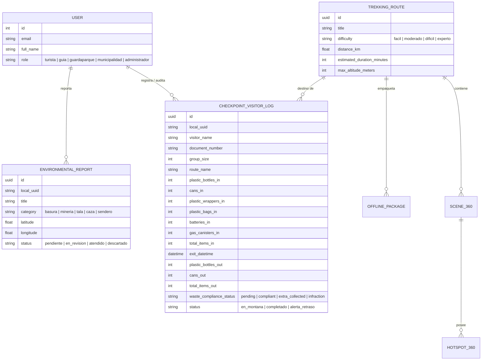

# 🏔️ HUAGURUNCHO 360
### Plataforma Integral de Turismo Sostenible, Conservación de Alta Montaña y Control de Residuos "Huella Cero"

> **Ubicación:** Distrito de Huachón, Provincia y Departamento de Pasco, Perú  
> **Área de Influencia:** Cordillera del Nevado Huaguruncho (5,742 m s.n.m.)  
> **Versión:** 2.0.0 (Edición Offline-First & Guardaparques)  
> **Fecha:** Octubre 2026  

---

## 📑 Tabla de Contenidos
1. [¿Qué es HUAGURUNCHO 360?](#1-qué-es-huaguruncho-360)
2. [¿Para qué sirve? Problemáticas y Soluciones](#2-para-qué-sirve-problemáticas-y-soluciones)
3. [Perfiles de Usuario y Casos de Uso](#3-perfiles-de-usuario-y-casos-de-uso)
4. [Arquitectura Tecnológica del Sistema](#4-arquitectura-tecnológica-del-sistema)
5. [Módulos del Sistema y Cómo Funcionan](#5-módulos-del-sistema-y-cómo-funcionan)
   - [5.1 Módulo Exclusivo de Guardabosques (Puesto de Control y Huella Cero)](#51-módulo-exclusivo-de-guardabosques-puesto-de-control-y-huella-cero)
   - [5.2 Exploración de Rutas y Paquetes 100% Offline](#52-exploración-de-rutas-y-paquetes-100-offline)
   - [5.3 Tour Virtual 360° Real e Interactivo](#53-tour-virtual-360-real-e-interactivo)
   - [5.4 Live Trekking GPS y Seguridad de Alta Montaña](#54-live-trekking-gps-y-seguridad-de-alta-montaña)
   - [5.5 Eco-Reportes Ambientales Ciudadanos](#55-eco-reportes-ambientales-ciudadanos)
   - [5.6 Pasaporte del Guardián Ecológico (Gamificación)](#56-pasaporte-del-guardián-ecológico-gamificación)
   - [5.7 Directorio Comunitario y Desarrollo Local de Huachón](#57-directorio-comunitario-y-desarrollo-local-de-huachón)
   - [5.8 Portal Web Central y Landing HTMX](#58-portal-web-central-y-landing-htmx)
6. [Mecanismo Offline-First y Sincronización Idempotente](#6-mecanismo-offline-first-y-sincronización-idempotente)
7. [Estructura del Proyecto (Monorepo)](#7-estructura-del-proyecto-monorepo)
8. [Modelo de Datos Central](#8-modelo-de-datos-central)
9. [Guía Rápida de Instalación y Ejecución](#9-guía-rápida-de-instalación-y-ejecución)
10. [Credenciales y Cuentas Preconfiguradas](#10-credenciales-y-cuentas-preconfiguradas)
11. [Impacto Social, Ecológico y Proyección Futura](#11-impacto-social-ecológico-y-proyección-futura)

---

## 1. ¿Qué es HUAGURUNCHO 360?

**HUAGURUNCHO 360** es un ecosistema digital compuesto por una **aplicación móvil multiplataforma (Flutter)** y un **backend administrativo central (Django REST Framework)**, diseñado específicamente para gestionar, salvaguardar y promover el turismo responsable en el **Nevado Huaguruncho** ("El Coloso de Pasco", 5,742 m s.n.m.), ubicado en el distrito de Huachón, Pasco, Perú.

El sistema fusiona tres grandes pilares:
1. **Turismo de Aventura y Montaña Responsable:** Guía interactiva de senderos, tours virtuales en 360 grados, perfiles altimétricos, audioguías culturales en quechua/español y telemetría meteorológica.
2. **Conservación Ambiental de Alta Montaña ("Huella Cero"):** Registro estricto del ingreso y retorno de residuos sólidos (botellas plásticas, latas, envoltorios, pilas, balones de gas) con inspección obligatoria en el puesto de control del guardaparques.
3. **Resiliencia Extrema sin Conexión (Offline-First):** Toda la aplicación móvil está diseñada para funcionar sin internet ni cobertura celular, almacenando datos localmente en SQLite (Drift) y sincronizando de forma segura cuando se recupera conectividad.

```
       ┌────────────────────────────────────────────────────────┐
       │                    HUAGURUNCHO 360                     │
       └───────────────────────────┬────────────────────────────┘
                                   │
         ┌─────────────────────────┼─────────────────────────┐
         ▼                         ▼                         ▼
┌──────────────────┐      ┌──────────────────┐      ┌──────────────────┐
│   TURISMO 360°   │      │   HUELLA CERO    │      │  OFFLINE-FIRST   │
│ Rutas, Panoramas │      │ Puesto de Control│      │ SQLite Local     │
│  Live GPS & SOS  │      │ Audito Residuos  │      │ Sync Idempotente │
└──────────────────┘      └──────────────────┘      └──────────────────┘
```

---

## 2. ¿Para qué sirve? Problemáticas y Soluciones

| Problemática en la Cordillera | Solución Implementada en HUAGURUNCHO 360 |
|---|---|
| **Cero conectividad en alta montaña:** En las faldas y campamentos del nevado no existe señal celular ni datos móviles. | **Arquitectura 100% Offline-First:** Base de datos local en SQLite que permite consultar rutas, registrar ingresos, grabar tracks GPS y reportar incidentes sin internet. |
| **Contaminación por residuos abandonados:** Turistas dejan botellas, latas y plásticos en lagunas glaciares y senderos. | **Módulo de Puesto de Control "Huella Cero":** El guardaparques audita cuántos residuos sube cada grupo e inspecciona que el 100% retorne al descender. |
| **Accidentes y extravíos en altura:** Clima extremo, congelamiento, mal de altura (soroche) y niebla espesa. | **Live Trekking GPS + Botón SOS:** Registro de ruta con telemetría satelital, checklists de seguridad y botón de emergencia con coordenadas SMS automáticas. |
| **Falta de visibilidad para los pobladores locales:** El turismo formal a menudo no beneficia a las comunidades de Huachón. | **Directorio Comunitario Integrado:** Visibilidad para arrieros, guías locales acreditados, hospedajes familiares y restaurantes típicos. |
| **Poco conocimiento previo de la ruta:** Turistas sin preparación intentan ascensos técnicos sin conocer la dificultad. | **Tours Virtuales 360° Interactivos:** Exploración previa en 360° con hotspots de advertencia geológica y dificultad real. |

---

## 3. Perfiles de Usuario y Casos de Uso

El sistema cuenta con un sistema de **Control de Acceso Basado en Roles (RBAC)** que segmenta estrictamente la interfaz y los privilegios:

```
┌───────────────────────────────────────────────────────────────────────────────┐
│                               ROLES DEL SISTEMA                               │
├─────────────────┬─────────────────────────────────────────────────────────────┤
│ Turista         │ Explorar rutas, 360°, Live GPS, SOS, Eco-Pasaporte, Reportes│
│ Guía de Montaña │ Información técnica de rutas, reportes de estado de sendero │
│ Guardaparque    │ Acceso exclusivo al Puesto de Control y Retorno de Residuos │
│ Municipalidad   │ Supervisión de visitantes, métricas de residuos y reportes  │
│ Administrador   │ Control maestro total del backend y gestión de usuarios     │
└─────────────────┴─────────────────────────────────────────────────────────────┘
```

### 1. El Turista / Montañista
* Descarga el paquete offline de la ruta antes de salir de Huachón o Pasco.
* Explora la ruta en 360° para conocer el terreno, los campamentos base y las lagunas.
* Realiza el ascenso con el mapa satelital GPS en tiempo real.
* Acude al Puesto de Control en el Abra Huachón para registrar su ascenso y declarar sus residuos.
* Al bajar, entrega sus residuos al guardaparque para certificar su descenso responsable y ganar su **Sello de Guardián Ecológico**.

### 2. El Guardaparque / Guardabosques (Módulo Exclusivo)
* **Acceso Restringido:** Este apartado es completamente invisible para turistas y usuarios no autenticados.
* Opera en la caseta de control sin necesidad de electricidad estable ni conexión a internet.
* **Registro de Ingreso:** Registra al líder de expedición, integrantes, número de documento, ruta elegida y el inventario detallado de residuos que suben (botellas, latas, empaques, gas, etc.).
* **Monitoreo:** Consulta la lista de personas que se encuentran activamente "En Montaña" y cuánto tiempo llevan en ruta.
* **Inspección de Descenso:** Al regresar el grupo, cuenta los residuos devueltos y emite la calificación de cumplimiento (**Conforme**, **Meritorio** o **Infracción**).
* **Sincronización:** Cuando baja al pueblo o conecta el dispositivo a WiFi, pulsa "Sincronizar" para actualizar el servidor central.

### 3. La Municipalidad Distrital de Huachón
* Monitorea cuántos turistas ingresan mensualmente al nevado.
* Conoce cuántos kilos o unidades de residuos sólidos se salvaron de quedar abandonados en el glaciar.
* Gestiona alertas tempranas, accidentes o reportes de delitos ambientales (tala, minería ilegal, caza).

---

## 4. Arquitectura Tecnológica del Sistema

El proyecto está diseñado bajo un modelo de arquitectura limpia y desacoplada, contenido en un **Monorepo**:

```
                          ARQUITECTURA HUAGURUNCHO 360
                          
        [ APLICACIÓN MÓVIL FLUTTER ]           [ PORTAL WEB & LANDING ]
        - Clean Architecture + Riverpod        - Django Templates + HTMX
        - Drift SQLite (Offline-First)         - Tailwind CSS + Glassmorphism
        - WebGL Panoramic Engine               - Visualizador 360 Web
        - Geolocalización Satelital GPS        - Dashboard Administrativo
                     │                                     │
                     └─────────────────┬───────────────────┘
                                       │ HTTPS / JSON REST API
                                       │ (Token JWT Bearer)
                                       ▼
                       [ BACKEND CENTRAL DJANGO REST ]
                       - Django 5.x + DRF
                       - PostgreSQL / SQLite GIS
                       - RBAC (Role-Based Access Control)
                       - Batch Sync Idempotente
                       - OpenAPI 3.0 / Swagger UI
                                       │
                                       ▼
                       [ BASE DE DATOS Y MEDIA CLOUD ]
                       - Modelos de Rutas, Escenas 360, Hotspots
                       - Bitácora de Guardaparques (Checkpoint Logs)
                       - Eco-Reportes Ciudadanos y Evidencias
```

### Tecnologías Clave:
* **Móvil:** Flutter 3.x, Dart 3.x, Riverpod (State Management), Drift (SQLite Engine), GoRouter (Navegación declarativa), Dio (Networking & Interceptores), Geofence & Location Services.
* **Backend:** Python 3.12, Django 5.x, Django REST Framework, SimpleJWT, Pillow, django-cors-headers, drf-spectacular.
* **Web:** Landing page con HTMX para micro-interacciones sin sobrecarga de JavaScript, CSS moderno con estética *Andean Peaks*.

---

## 5. Módulos del Sistema y Cómo Funcionan

```
┌───────────────────────────────────────────────────────────────────────────────┐
│                           MÓDULOS DE LA APLICACIÓN                            │
├───────────────────────┬──────────────────────────┬────────────────────────────┤
│ 🛡️ Puesto de Control   │ 🗺️ Rutas y Mapas         │ 🔄 Tour Virtual 360°       │
│ 📡 Live Trekking GPS  │ 🚨 Botón de SOS y Clima  │ 🎒 Pasaporte del Guardián  │
│ 📸 Eco-Reportes       │ 🏘️ Directorio Huachón    │ 🌐 Landing Page Web        │
└───────────────────────┴──────────────────────────┴────────────────────────────┘
```

---

### 5.1 Módulo Exclusivo de Guardabosques (Puesto de Control y Huella Cero)
Es el núcleo de protección ambiental del nevado:
1. **Ocultamiento por Seguridad:**
   - Si un usuario no está logueado o tiene rol de turista, el módulo **no aparece** en la barra, ni en el inicio, ni en el perfil.
   - Si se intenta ingresar forzando la ruta interna (`/ranger-checkpoint`), la aplicación bloquea la pantalla mostrando una alerta de acceso restringido con candado.
2. **Registro de Entrada / Ascenso:**
   - Nombre del visitante o líder de grupo, DNI / Pasaporte, teléfono, cantidad de personas en el grupo.
   - Ruta seleccionada (ej. *Laguna Huaguruncho - Campamento Base*, *Glaciar Sur*, etc.) y guía acompañante.
   - **Inventario Declarado de Residuos:**
     - 🍶 Botellas plásticas
     - 🥫 Latas y conservas
     - 🍫 Envoltorios de golosinas / snacks
     - 🛍️ Bolsas plásticas
     - 🔋 Pilas y baterías
     - ⛽ Balones o cartuchos de gas para camping
     - 📦 Otros residuos específicos
   - Al confirmar, se almacena instantáneamente en el SQLite local del teléfono.
3. **Tablero de Estado "En Montaña":**
   - Muestra tarjetas de todas las expediciones que están actualmente en el nevado.
   - Muestra el tiempo transcurrido desde el ingreso (`Hace 3h 15m`).
   - Muestra el contador total de residuos que deben retornar.
4. **Registro de Salida / Check-out e Inspección:**
   - Al descender, el guardaparque solicita al grupo los residuos que traen en sus mochilas.
   - Cuenta cada categoría y el sistema compara automáticamente:
     - 🟢 **Conforme (Retornó 100% de Residuos):** Se devuelve la misma o mayor cantidad de empaques.
     - 🌟 **Meritorio (+ extra recolectado):** El montañista trajo basura extra que recogió del camino, premiando su compromiso.
     - 🔴 **Infracción (Faltan residuos):** Faltan residuos que subieron y no bajaron. Permite ingresar el acta de infracción y observaciones para la municipalidad.
5. **Sincronización por Lotes (Batch Sync):**
   - Envía todas las entradas y salidas almacenadas en SQLite al servidor central con un solo toque al tener red.

---

### 5.2 Exploración de Rutas y Paquetes 100% Offline
* Catálogo de senderos con fotos panorámicas, ficha técnica (distancia en km, desnivel positivo, altitud máxima, tiempo estimado y nivel de dificultad técnica).
* **Gestor de Paquetes Offline:** El usuario puede pulsar "Descargar Paquete" mientras está en la ciudad. El teléfono descarga los metadatos de la ruta, waypoints, recomendaciones y panoramas equirectangulares para utilizarlos en la cordillera sin gastar datos.

---

### 5.3 Tour Virtual 360° Real e Interactivo
* Motor WebGL autónomo optimizado para dispositivos móviles.
* Permite al usuario "pararse" virtualmente en el Mirador de Huaguruncho, la Laguna Añilcocha o el glaciar.
* **Hotspots Interactivos:** Al tocar iconos flotantes en la escena 360°, el usuario puede:
  - Saltar de una escena a la siguiente (navegación espacial).
  - Escuchar narraciones en audio sobre la flora o la leyenda del nevado.
  - Ver advertencias geológicas (zonas de caída de rocas, grietas glaciares).

---

### 5.4 Live Trekking GPS y Seguridad de Alta Montaña
* **Grabador de Ruta Satelital:** Monitorea la posición en tiempo real mediante el chip GPS interno (que funciona aún con el teléfono en modo avión).
* Muestra distancia recorrida, altitud actual (m s.n.m.), velocidad de avance y ritmo de ascenso.
* **Checklist de Seguridad:** Lista interactiva para validar crampones, piolet, ropa térmica de tres capas, linterna frontal y raciones antes de partir.
* **Botón SOS de Emergencia:** Dispara una llamada directa a la Policía de Alta Montaña / Serenazgo de Huachón y prepara un mensaje SMS con las coordenadas latitud/longitud exactas del montañista.

---

### 5.5 Eco-Reportes Ambientales Ciudadanos
* Permite a cualquier turista o guía denunciar agresiones al ecosistema:
  - 🗑️ Basura acumulada
  - ⛏️ Indicios de minería no autorizada
  - 🔥 Fogatas o quemas de pastizales
  - 🦌 Caza furtiva de vicuñas o cóndores
  - 🚶 Erosión severa de senderos
* Captura obligatoria de foto como evidencia y coordenadas GPS automáticas.
* Si no hay red, el reporte queda encolado localmente y se sincroniza al retornar a la ciudad.

---

### 5.6 Pasaporte del Guardián Ecológico (Gamificación)
* Fomenta las buenas prácticas mediante una cartilla digital de sellos y medallas:
  - **Sello Laguna Huaguruncho:** Por completar la caminata base.
  - **Medalla Guardián de la Cumbre:** Por completar el ascenso con 100% de retorno de residuos.
  - **Medalla Eco-Héroe:** Por reportar puntos críticos de residuos o recolectar basura ajena en el sendero.

---

### 5.7 Directorio Comunitario y Desarrollo Local de Huachón
* Promoción de la economía comunal del distrito de Huachón:
  - Asociación de Arrieros y Alquiler de Caballos.
  - Hospedajes rurales y zonas de camping autorizadas.
  - Guías oficiales de montaña certificados por SERNANP / Municipalidad.
  - Platos típicos locales (trucha frita, caldo de cabeza, pachamanca).

---

### 5.8 Portal Web Central y Landing HTMX
* Portal de bienvenida para promocionar el destino a nivel nacional e internacional.
* Demostración interactiva del visor 360° en navegadores web.
* Telemetría del clima en tiempo real conectada a estaciones meteorológicas.
* Consulta del sello de guardián ecológico y formulario de suscripción a boletines de conservación.

---

## 6. Mecanismo Offline-First y Sincronización Idempotente

El mayor desafío técnico de Huaguruncho es la **ausencia total de señal de telecomunicaciones** en el área protegida. El sistema resuelve esto mediante un patrón de **cola local con reconciliación por lotes**:

```
[ Guardaparque / Turista ]
           │
           ▼
[ Acción en la App Móvil ] (Registrar Entrada / Salida / Reporte)
           │
           ▼
[ Drift SQLite Local ] ──► Guarda con local_uuid único (UUIDv4)
                           Marca: sync_status = 'pending'
           │
           │ (Pasan horas o días sin señal...)
           ▼
[ Se detecta señal de Internet / WiFi ]
           │
           ▼
[ Batch Sync Dispatcher ] ──► Envía JSON { "entries": [ ... ] } a:
                               POST /api/v1/checkpoint-entries/sync-batch/
           │
           ▼
[ Backend Django REST ]
     ├── ¿Existe local_uuid?
     │     ├── NO  ──► Crea nuevo registro con hash de integridad
     │     └── SÍ  ──► Reconcilia datos (idempotencia, cero duplicados)
     └── Responde HTTP 200 { "results": [{ "status": "synced" }] }
           │
           ▼
[ Drift SQLite Local ] ──► Actualiza sync_status = 'synced' y synced_at = now()
```

---

## 7. Estructura del Proyecto (Monorepo)

```
Aqui en Huaguruncho/
├── SISTEMA_HUAGURUNCHO_360.md       # Documento maestro del sistema
├── README.md                         # Guía rápida de inicio
├── docker-compose.yml                # Orquestación con contenedores
├── docs/                             # Documentación técnica extendida
│   ├── api.md                        # Catálogo de endpoints REST
│   ├── arquitectura.md               # Detalle de capas y patrones
│   ├── decisiones-tecnicas.md        # Justificación tecnológica
│   ├── instalacion.md                # Configuración de entornos
│   └── captura-de-panoramas.md       # Guía para fotógrafos 360
├── backend/                          # Backend Django REST
│   ├── manage.py
│   ├── requirements.txt              # Dependencias Python
│   ├── config/                       # Settings modulares, URLs y Swagger
│   └── apps/
│       ├── accounts/                 # Usuarios personalizados y RBAC
│       ├── common/                   # Modelos base UUID, permisos y utilidades
│       ├── tourism/                  # Rutas, 360, Guardaparques, Biodiversidad
│       ├── environmental_reports/    # Eco-reportes y sincronización
│       ├── offline_packages/         # Paquetes y manifiestos descargables
│       └── landing/                  # Landing page HTMX y vistas públicas
└── mobile/                           # Aplicación Móvil Flutter
    ├── pubspec.yaml                  # Dependencias Flutter
    ├── assets/                       # Imágenes, panoramas y motores 360
    └── lib/
        ├── app/                      # Rutas GoRouter y tema visual
        ├── core/                     # Drift SQLite DB, cliente HTTP Dio, GPS
        └── features/
            ├── auth/                 # Login, registro y sesión de usuario
            ├── checkpoint/           # Módulo exclusivo de Guardabosques
            ├── home/                 # Pantalla principal y perfil
            ├── routes/               # Exploración y detalle de senderos
            ├── tour_360/             # Visor panorámico 360 interactivo
            ├── live_trekking/        # Grabador satelital de ruta GPS
            ├── reports/              # Formulario y lista de Eco-Reportes
            ├── eco_passport/         # Cartilla de sellos y medallas
            ├── safety/               # Checklists y recomendaciones de montaña
            └── community/            # Directorio y muro comunitario
```

---

## 8. Modelo de Datos Central



---

## 9. Guía Rápida de Instalación y Ejecución

### 9.1 Backend (Django)
```bash
# 1. Navegar a la carpeta backend
cd backend

# 2. Activar entorno virtual
source .venv/bin/activate    # En Windows: .venv\Scripts\Activate.ps1

# 3. Instalar librerías
pip install -r requirements.txt

# 4. Aplicar migraciones a la base de datos
python manage.py migrate

# 5. Cargar datos semilla de Huaguruncho (rutas, guardaparques, etc.)
python manage.py seed_huaguruncho

# 6. Iniciar el servidor
python manage.py runserver 0.0.0.0:8000
```
* **Panel de Administración:** [http://127.0.0.1:8000/admin/](http://127.0.0.1:8000/admin/)
* **Documentación Interactiva Swagger:** [http://127.0.0.1:8000/api/docs/](http://127.0.0.1:8000/api/docs/)

---

### 9.2 Aplicación Móvil (Flutter)
```bash
# 1. Navegar a la carpeta mobile
cd mobile

# 2. Descargar dependencias
flutter pub get

# 3. (Opcional) Regenerar código Drift SQLite si se modifican tablas
dart run build_runner build --delete-conflicting-outputs

# 4. Conectar dispositivo físico Android o emulador
# Si se usa teléfono físico por USB, habilitar túnel al servidor local:
adb reverse tcp:8000 tcp:8000

# 5. Ejecutar la aplicación
flutter run
```

---

## 10. Credenciales y Cuentas Preconfiguradas

Para facilitar la evaluación de todos los roles del sistema, se han creado cuentas semilla listas para usar:

| Rol | Correo Electrónico | Contraseña | ¿Ve el Puesto de Control? |
|---|---|---|:---:|
| **Guardaparque** | `guardaparque@huaguruncho.pe` | `Huaguruncho2026!` | ✅ **SÍ (Acceso Total)** |
| **Municipalidad** | `municipalidad@huachon.gob.pe` | `Huaguruncho2026!` | ✅ **SÍ (Auditoría)** |
| **Administrador** | `admin@huaguruncho.pe` | `Huaguruncho2026!` | ✅ **SÍ (Control Total)** |
| **Guía de Montaña** | `guia@huaguruncho.pe` | `Huaguruncho2026!` | ❌ No (Oculto) |
| **Turista** | *(Cualquier cuenta registrada)* | *(Clave elegida)* | ❌ No (Oculto) |

---

## 11. Impacto Social, Ecológico y Proyección Futura

### Impacto Ecológico Directo
* **Cero Basura en el Glaciar:** Al comprometer legal y moralmente a cada expedición a regresar con el 100% de sus residuos, se evita la degradación de las lagunas Añilcocha y Huaguruncho.
* **Mapeo Satelital de Amenazas:** Los eco-reportes ciudadanos permiten a SERNANP y al comité comunal intervenir rápidamente ante quemas ilegales o campamentos clandestinos.

### Impacto Comunitario y Social
* **Economía Circular en Huachón:** El directorio comunitario formaliza el trabajo de los comuneros arrieros y hospedajes locales, distribuyendo los ingresos turísticos directamente a la población local.
* **Preservación Cultural:** Las audioguías y fichas de biodiversidad rescatan la toponimia quechua y las leyendas ancestrales transmitidas de generación en generación sobre el Apu Huaguruncho.

---
*Desarrollado con orgullo para la conservación del Nevado Huaguruncho y la comunidad de Huachón, Pasco.* 🏔️🇵🇪
